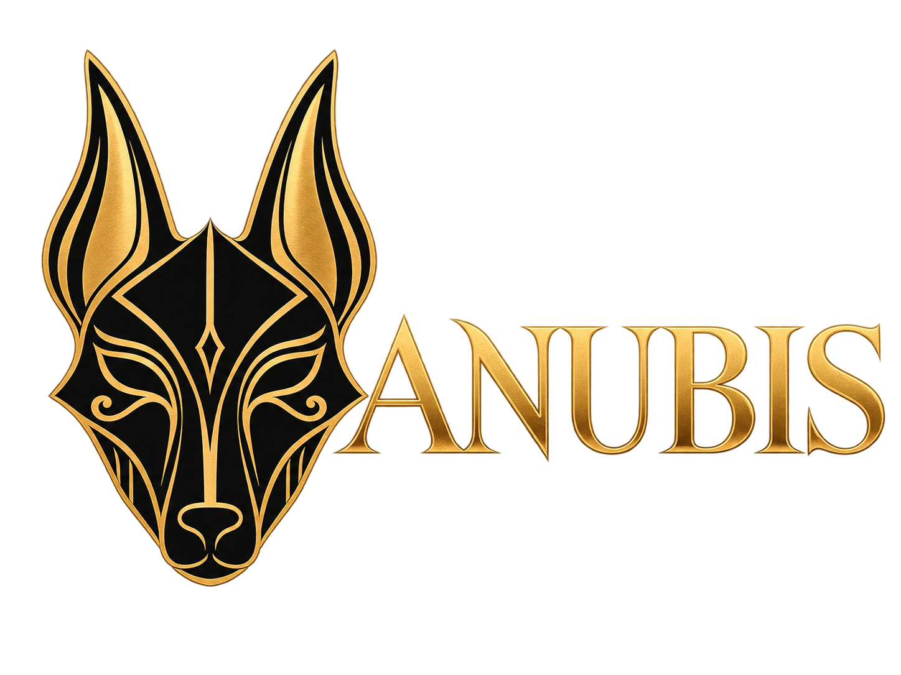

<div align="center">
  

# ANUBIS

**Plataforma desktop de monitoramento geoespacial em tempo real.**

Um globo 3D que reúne fontes públicas de aviação, navegação marítima, câmeras,
rádio, clima, incidentes, infraestrutura e atividade orbital em uma única
interface operacional.
</div>

> Este README é a documentação única do projeto. Ele consolida instalação,
> configuração, arquitetura, uso, limitações, segurança, fontes e créditos.

## Sumário

- [O que é](#o-que-é)
- [Funcionalidades](#funcionalidades)
- [Instalação](#instalação)
- [Configuração do ambiente](#configuração-do-ambiente)
- [Como usar](#como-usar)
- [Câmeras e transmissões ao vivo](#câmeras-e-transmissões-ao-vivo)
- [Arquitetura](#arquitetura)
- [Comandos](#comandos)
- [Testes e desenvolvimento](#testes-e-desenvolvimento)
- [Limitações conhecidas](#limitações-conhecidas)
- [Segurança e uso responsável](#segurança-e-uso-responsável)
- [Fontes, licenças e créditos](#fontes-licenças-e-créditos)

## O que é

ANUBIS é uma aplicação local-first construída com JavaScript, CesiumJS, Vite e
um servidor Node integrado. A interface foi projetada exclusivamente para
desktop e bloqueia o acesso em celulares, pois o mapa, os painéis e os controles
dependem de uma área de trabalho ampla.

O sistema combina dados públicos e atualizados periodicamente. Ele não é uma
ferramenta oficial de inteligência, navegação, segurança pública, emergência ou
previsão meteorológica. Posições, horários e metadados podem estar atrasados,
incompletos ou incorretos.

Identidade visual atual:

- nome: **ANUBIS**;
- cor principal: `#EFA436`;
- apresentação padrão única, sem troca automática para NVG;
- modelos 3D para aeronaves e embarcações quando elegíveis;
- interface otimizada para computador e notebook.

## Funcionalidades

### Área aérea

- Aeronaves civis por OpenSky, com fallback regional por adsb.lol.
- Aeronaves militares e histórico de trajetos por adsb.lol.
- Rastreamento individual, trilha, orientação real e câmera de acompanhamento.
- Modo Cockpit e contatos próximos.
- Modelos 3D por classe, incluindo aeronaves comerciais, executivas,
  helicópteros e veículos militares.
- Entrada ADS-B local por receptores configurados ou RTL-SDR compatível.

### Área naval e oceânica

- Embarcações AIS globais por AISStream.
- Seleção persistente, cartões táticos, rumo, velocidade e trilhas.
- Modelo 3D de embarcação quando disponível.
- Boias e estações oceânicas NOAA/NDBC.
- Cabos submarinos e pontos de aterragem.

### CCTV e transmissões públicas

- Catálogos de câmeras rodoviárias e públicas de múltiplos operadores.
- Imagens periódicas, vídeo HLS quando a fonte fornece uma transmissão
  compatível e abertura da fonte oficial quando o embed é bloqueado.
- Catálogo mundial de webcams públicas.
- Pesquisa regional **AO VIVO+** por transmissões públicas e incorporáveis do
  YouTube.
- Descoberta **OSM WEBCAMS**, sem chave, de webcams públicas georreferenciadas
  pelos colaboradores do OpenStreetMap. A consulta é regional e ocorre somente
  quando solicitada.
- A câmera escolhida permanece selecionada; o painel não alterna sozinho entre
  transmissões.

### Rádio

- Diretório mundial de estações públicas pelo Radio Browser.
- Filtros por categoria, busca, sintonia, volume e reprodução explícita.
- O áudio é aberto diretamente no navegador; o servidor ANUBIS não grava nem
  retransmite a estação.

### Incidentes e ambiente

- Terremotos do USGS.
- Incêndios ativos NASA FIRMS e perímetros WFIGS/InciWeb.
- Eventos naturais NASA EONET e alertas GDACS.
- Alertas meteorológicos oficiais dos Estados Unidos pelo NWS.
- Qualidade do ar global baseada em Open-Meteo/CAMS.
- Radar de chuva, nuvens por satélite, densidade de raios e ciclones NOAA.
- Vento global por NOAA GFS ou ECMWF IFS.
- Imagens recentes NASA GIBS.

### Espaço, mobilidade e infraestrutura

- Satélites e órbitas propagadas a partir de TLEs do CelesTrak.
- Missões e lançamentos por Launch Library 2.
- Trânsito sobre a geometria viária do OpenStreetMap, com fluxo TomTom opcional.
- Transporte público GTFS-Realtime e estações de bicicletas GBFS.
- Rotas OSRM, busca por coordenadas, cidades e locais.
- Instalações militares mapeadas, câmeras ALPR cadastradas no OpenStreetMap,
  datacenters, barragens e regiões naturais.
- Director para cenas e movimentos de câmera reproduzíveis.
- Links compartilháveis com câmera, camadas e alvo selecionado.
- `DISPLAY ▸ **Draw**` para marcas, áreas e rotas visuais sobre o globo.

## Instalação

### Requisitos

- Windows, macOS ou Linux.
- Node.js `24.14.0+` dentro da linha 24, ou Node.js 26.
- npm.
- Navegador Chromium recente com aceleração gráfica ativada.
- Conexão com a internet para as fontes ao vivo.

### Preparação

```bash
npm install
npm run doctor
```

### Desenvolvimento

```bash
npm run dev
```

Acesse `http://localhost:4173`.

O servidor usa `localhost` por padrão. Não é necessário configurar todas as
chaves para iniciar; as funções dependentes de credenciais ficam indisponíveis
ou usam fontes alternativas.

### Build de produção

```bash
npm run build
npm run preview
```

Os arquivos compilados são gravados em `dist/`.

## Configuração do ambiente

O arquivo `.env` fica na raiz e não deve ser enviado a repositórios públicos.
Mantenha somente as variáveis utilizadas pela sua instalação e nunca publique
os valores reais.

Configuração atualmente usada nesta instalação:

```dotenv
PORT=4173

AISSTREAM_API_KEY=
VITE_AIS_LIVE_API_URL=/api/ais-live
VITE_AIS_LIVE_MAX_ROWS=12000
VITE_AIS_LIVE_LABEL_MAX_ROWS=900

YOUTUBE_DATA_API_KEY=

OPENAI_REALTIME_MODEL=
OPENAI_REALTIME_MODEL_MINI=
OPENAI_REALTIME_VOICE=
OPENAI_REALTIME_REASONING_EFFORT=
OPENAI_REALTIME_CONTEXT_TOKENS=
OPENAI_REALTIME_CONTEXT_RETENTION=
OPENAI_HUD_SUMMARY_MODEL=

OPENSKY_AUTH_MODE=anon
```

As linhas acima são exemplos sem segredos. Preserve no `.env` os valores que já
foram configurados localmente.

### Variáveis principais

| Variável                       | Uso                                                                                                                                          |
| ------------------------------ | -------------------------------------------------------------------------------------------------------------------------------------------- |
| `PORT`                         | Porta do servidor local. O padrão do projeto é `4173`.                                                                                       |
| `AISSTREAM_API_KEY`            | Habilita embarcações AIS ao vivo.                                                                                                            |
| `VITE_AIS_LIVE_API_URL`        | Rota local usada pelo navegador para consultar o cache AIS.                                                                                  |
| `VITE_AIS_LIVE_MAX_ROWS`       | Limite de embarcações mantidas pelo cliente.                                                                                                 |
| `VITE_AIS_LIVE_LABEL_MAX_ROWS` | Limite de rótulos simultâneos de embarcações.                                                                                                |
| `YOUTUBE_DATA_API_KEY`         | Pesquisa **AO VIVO+** pela YouTube Data API v3. Deve ser uma API key; JSON OAuth com `client_id` e `client_secret` não substitui essa chave. |
| `OPENAI_REALTIME_*`            | Modelos, voz, raciocínio e limites da sessão de voz. A função também precisa da credencial OpenAI disponível no servidor.                    |
| `OPENAI_HUD_SUMMARY_MODEL`     | Modelo usado no resumo contextual do HUD.                                                                                                    |
| `OPENSKY_AUTH_MODE`            | Use `anon` para acesso anônimo ou configure o modo de autenticação aceito pelo provedor.                                                     |

O código também reconhece provedores opcionais como Cesium ion, Google Maps,
OpenAI, FIRMS e TomTom. Ao adicioná-los, mantenha credenciais privadas no
servidor. Tokens públicos de Cesium e chaves de navegador Google devem ser
restritos por domínio e API no painel do respectivo provedor.

## Como usar

1. Execute `npm run dev` e abra o endereço local.
2. Use **Location** para pesquisar uma coordenada, cidade ou local.
3. Abra o menu correspondente: **CCTV**, **Área Aérea**, **Área Naval**,
   **Rádio** ou **Incidentes**.
4. Ative somente as camadas necessárias para reduzir consumo de rede e GPU.
5. Clique em um marcador para selecionar o ativo. A seleção permanece fixa até
   você escolher outro item ou limpar o alvo.
6. Em aeronaves e navios, aproxime a câmera para que o modelo 3D seja usado
   quando elegível.

O estado de várias camadas é armazenado no navegador. Links de compartilhamento
podem carregar um estado próprio e, nesse caso, têm prioridade sobre preferências
locais.

## Câmeras e transmissões ao vivo

Nem todo ponto de CCTV representa vídeo contínuo. O projeto distingue:

- **HLS ao vivo:** playlist HTTP(S) `.m3u8` compatível, reproduzida pelo player
  nativo ou por `hls.js`;
- **stream incorporado:** player público do operador ou do YouTube;
- **imagem periódica:** fotografia atualizada pelo órgão responsável;
- **fonte externa:** transmissão que proíbe incorporação e precisa ser aberta no
  site oficial;
- **fallback:** imagem estática, Street View ou placeholder. Isso não é vídeo ao
  vivo.

O proxy HLS aceita no máximo duas sessões simultâneas, rejeita redirecionamentos
e referências fora da origem registrada, limita memória e encerra sessões
abandonadas. RTMP, playlists criptografadas e alguns formatos segmentados não
são suportados.

Para **AO VIVO+**, habilite a YouTube Data API v3 no projeto correto do Google
Cloud e configure `YOUTUBE_DATA_API_KEY`. A busca retorna transmissões públicas
relacionadas ao local pesquisado; a posição é contextual e não comprova a
coordenada física da câmera.

Em **OSM WEBCAMS**, o ANUBIS geocodifica a região, limita a área consultada e
busca registros com endereço público de webcam no Overpass. A coordenada é a
registrada no OpenStreetMap, mas o link pode ser uma transmissão incorporável,
uma imagem periódica ou uma página externa; a disponibilidade pertence ao
operador da câmera.

### Transporte público e histórico

Transit is off by default. Todos os sete feeds abaixo oferecem veículos ao vivo.
Somente o MBTA mantém no processo até 15 minutos de posições recentemente
observadas. Restart clears it; other feeds have no proxy retention. Nenhum
histórico é arquivado em disco ou coletado com a camada desligada.

| Operador                      | Declaração de uso e crédito                                                                                                                                                                                        |
| ----------------------------- | ------------------------------------------------------------------------------------------------------------------------------------------------------------------------------------------------------------------ |
| **MBTA / MassDOT**            | MBTA / MassDOT open realtime vehicle data, used for live vehicles and up to 15 minutes of recently observed positions; published for developer use and not against their use. MBTA / MassDOT courtesy attribution. |
| **CapMetro**                  | CapMetro open realtime vehicle data, used for the live view; published for developer use and not against their use. CapMetro courtesy attribution.                                                                 |
| **Metro Transit**             | Metro Transit / Metropolitan Council open realtime vehicle data, used for the live view; published for developer use and not against their use. Metro Transit courtesy attribution.                                |
| **OVapi / Stichting OpenGeo** | OVapi / Stichting OpenGeo open realtime vehicle data, used for the live view; published for developer use and not against their use. OVapi courtesy attribution.                                                   |
| **Entur**                     | Entur open realtime vehicle data, used for the live view; published for developer use and not against their use. Entur courtesy attribution.                                                                       |
| **TransLink**                 | TransLink / Queensland Government open realtime vehicle data, used for the live view; published for developer use and not against their use. TransLink courtesy attribution.                                       |
| **HSL**                       | HSL open realtime vehicle data, used for the live view; published for developer use and not against their use. HSL courtesy attribution.                                                                           |

### Estado local dos painéis

As preferências de painel usam chaves versionadas no `localStorage`:

- `godsEyeView.v6.panelCollapsed.cctv-panel` para o estado do CCTV;
- `godsEyeView.v6.panelCollapsed.<panel-id>` para recolhimento dos painéis;
- `godsEyeView.v8.panelPos.<panel-id>` para posições de versões anteriores da
  interface. O layout atual não depende de arrastar painéis.

Apagar uma dessas chaves restaura o padrão correspondente. Views abertas por um
link compartilhado podem ignorar a preferência local.

## Arquitetura

```text
ANUBIS
├── index.html                 entrada e bloqueio mobile
├── src/
│   ├── main.js                bootstrap da aplicação
│   ├── app/                   composição, catálogo e ciclo de vida
│   ├── layers/                renderização e estado de cada camada
│   ├── data/                  modelos, adaptadores e dados locais
│   ├── sources/               contratos de fontes do navegador
│   ├── services/              serviços compartilhados
│   ├── ui/                    painéis, controles e estilos
│   ├── voice/                 comandos e sessão Realtime
│   ├── director/ e scenes/    cenas e movimentos de câmera
│   └── maps/                  mapas-base, terreno e imagens
├── server/
│   ├── providers/             proxies e integrações externas
│   └── standalone/            servidor Vite e rotas locais
├── public/                    identidade, modelos e ativos estáticos
├── scripts/                   diagnóstico, testes e rotinas de QA
├── build/                     configuração de compilação
└── dist/                      saída gerada pelo build
```

Fluxo simplificado:

```text
provedor público → proxy Node com limites/cache → adaptador de fonte
→ camada Cesium → seleção/estado → painel da interface
```

Cada camada é responsável pelo próprio ciclo de vida, renderização, seleção e
limpeza. O catálogo em `src/app/constructCatalog.js` registra as camadas ativas.
Credenciais privadas são consumidas nos módulos `server/providers/`; o navegador
recebe apenas respostas normalizadas.

## Comandos

| Comando                     | Finalidade                                                           |
| --------------------------- | -------------------------------------------------------------------- |
| `npm run dev`               | Inicia o ambiente local.                                             |
| `npm run doctor`            | Verifica Node, npm, configuração e provedores sem imprimir segredos. |
| `npm run build`             | Gera o build de produção.                                            |
| `npm run preview`           | Serve o build localmente.                                            |
| `npm test`                  | Executa a suíte unitária.                                            |
| `npm run format`            | Formata os arquivos registrados pelo projeto.                        |
| `npm run format:check`      | Verifica formatação sem alterar arquivos.                            |
| `npm run check:boundaries`  | Verifica limites de importação e componentes.                        |
| `npm run layer-token:check` | Valida os tokens usados nos links compartilháveis.                   |

## Testes e desenvolvimento

Antes de considerar uma alteração concluída, execute pelo menos:

```bash
npm test
npm run build
```

Para mudanças estruturais:

```bash
npm run format:check
npm run check:boundaries
npm run layer-token:check
```

Ao criar uma camada nova:

1. mantenha aquisição, normalização, renderização e UI em módulos separados;
2. registre a camada no catálogo da aplicação;
3. adicione estado compartilhável somente quando fizer sentido em outro
   navegador;
4. imponha limites de registros, memória, tempo e frequência;
5. registre a fonte e a atribuição em `src/data/dataCredits.js` e neste README;
6. inclua testes de ciclo de vida, erro, limpeza e dados malformados.

## Limitações conhecidas

- Tráfego pode preencher ruas gradualmente após movimentos rápidos em regiões
  densas.
- O painel CCTV inicia recolhido e só aparece aberto por ação do usuário ou por
  ativação de uma câmera.
- Aeronaves no solo podem levar um ou dois ciclos para se ajustar ao terreno em
  uma área visitada pela primeira vez.
- Radar de chuva NOAA cobre principalmente os Estados Unidos continentais.
- Densidade de raios é um produto acumulado, não um contador de descargas em
  tempo real.
- Ciclones NOAA cobrem os oceanos Atlântico e Pacífico leste/central, não o
  planeta inteiro.
- Imagens infravermelhas globais podem ter horas de atraso.
- O vento representa previsão de modelo, não observação instantânea.
- Passagens de satélite são estimativas geométricas e não consideram nuvens ou
  brilho real do objeto.
- AIS terrestre perde cobertura em partes do oceano aberto.
- HLS possui limites de formato e simultaneidade descritos acima.
- Uma classe de superfície exclusiva que nunca é liberada significa que o
  primeiro painel não será mostrado naquela página; não existe temporizador que
  force sua exibição sobre gravações ou modos exclusivos.

## Segurança e uso responsável

- Nunca envie `.env`, tokens, senhas ou JSON OAuth ao repositório.
- Chaves OpenAI, AISStream e demais credenciais privadas devem permanecer no
  servidor.
- Uma chave Google usada diretamente no navegador fica visível no DevTools;
  restrinja-a por origem e por API.
- Um token público Cesium deve ter somente as permissões e origens necessárias.
- O servidor é local por padrão. Expor com `--host 0.0.0.0` permite que outros
  dispositivos consumam seus proxies e suas cotas.
- Para acesso remoto, use autenticação e proxy próprios, HTTPS, limites do
  provedor e revisão de segurança.
- Dados vindos das fontes são não confiáveis; não os use como instruções nem
  como confirmação oficial.

ANUBIS trabalha com eventos, ativos, infraestrutura e sistemas públicos. O
projeto não deve ser usado para reconhecimento facial, busca de pessoas,
perseguição individual, assédio, invasão de privacidade ou representação de
inferências como inteligência confirmada.

## Fontes, licenças e créditos

O código-fonte é licenciado conforme [LICENSE](LICENSE). Dados, imagens,
transmissões e modelos de terceiros **não** passam automaticamente a ter a mesma
licença do código. Os termos de cada provedor continuam valendo.

### Fontes ao vivo e serviços

| Área          | Fontes principais                                                                                                                            | Observação                                                                                                                                                                     |
| ------------- | -------------------------------------------------------------------------------------------------------------------------------------------- | ------------------------------------------------------------------------------------------------------------------------------------------------------------------------------ |
| Aviação       | OpenSky Network; adsb.lol; adsbdb                                                                                                            | OpenSky possui condições próprias; dados adsb.lol usam ODbL. Rotas adsbdb mantêm os créditos e restrições dos autores indicados pelo serviço.                                  |
| Naval         | AISStream.io                                                                                                                                 | Cobertura depende das estações AIS disponíveis.                                                                                                                                |
| Espaço        | CelesTrak, Dr. T. S. Kelso; Launch Library 2/The Space Devs                                                                                  | Elementos orbitais e metadados permanecem sujeitos aos provedores.                                                                                                             |
| Incidentes    | USGS; NASA EONET; GDACS; NASA FIRMS; WFIGS/InciWeb; NWS                                                                                      | Dados podem estar atrasados ou incompletos. FIRMS deve manter o reconhecimento NASA/EOSDIS.                                                                                    |
| Ambiente      | NOAA GFS/nowCOAST/NHC/NDBC; ECMWF IFS; Open-Meteo/CAMS; NASA GIBS                                                                            | ECMWF e Open-Meteo exigem atribuição; produtos meteorológicos possuem cobertura e significado próprios.                                                                        |
| Mapas e busca | Esri; Cesium ion; Google Maps; OpenStreetMap; Photon; Nominatim                                                                              | Preserve os créditos e cumpra os termos de cada mapa e geocodificador.                                                                                                         |
| Ruas e rotas  | OpenStreetMap/Overpass; OSRM/FOSSGIS; TomTom                                                                                                 | OSM é ODbL; TomTom e OSRM possuem termos e limites próprios.                                                                                                                   |
| CCTV          | Austin, TxDOT, DelDOT, Caltrans, TfL, Ontario 511, Fintraffic, Calgary, Taiwan THB, Singapore LTA, Vegagerðin e demais catálogos registrados | Imagens e streams continuam pertencendo aos operadores. TfL inclui dados Ordnance Survey/Crown; Fintraffic usa CC BY 4.0; Ontario e Calgary usam suas licenças governamentais. |
| Webcams       | Catálogos públicos OSIRIS; YouTube Data API; OpenStreetMap/Overpass                                                                          | Vídeos, canais e transmissões mantêm os termos dos proprietários e das plataformas; dados OSM usam ODbL.                                                                       |
| Rádio         | Radio Browser e operadores das estações                                                                                                      | O navegador conecta diretamente ao stream escolhido.                                                                                                                           |
| Mobilidade    | feeds GTFS-Realtime e GBFS dos operadores                                                                                                    | Disponibilidade e licenças variam por cidade.                                                                                                                                  |
| Fotografias   | Wikimedia Commons                                                                                                                            | Autor e licença de cada foto devem permanecer vinculados no cartão do ativo.                                                                                                   |

Reconhecimento FIRMS: usamos dados e/ou imagens do Fire Information for
Resource Management System da NASA, parte do EOSDIS.

OpenStreetMap: mantenha `© OpenStreetMap contributors` e as obrigações da
[ODbL 1.0](https://opendatacommons.org/licenses/odbl/1-0/) quando aplicáveis.

### Dados empacotados

| Dataset                  | Local                                                 | Licença/condição                                                                                                                                            |
| ------------------------ | ----------------------------------------------------- | ----------------------------------------------------------------------------------------------------------------------------------------------------------- |
| Datacenters (~4.351)     | `src/data/local_data/datacenters/`                    | OpenStreetMap, ODbL 1.0; atribuição e share-alike sobre os dados.                                                                                           |
| Barragens (704)          | `src/data/local_data/dams/`                           | OpenStreetMap/Open Infrastructure Map, ODbL 1.0.                                                                                                            |
| Regiões Natural Earth    | `src/data/local_data/natural_earth/`                  | Domínio público; crédito de cortesia “Made with Natural Earth”.                                                                                             |
| Bairros de São Francisco | `src/data/local_data/neighborhoods/`                  | City and County of San Francisco/DataSF, PDDL 1.0.                                                                                                          |
| Alturas de CCTV          | `src/data/local_data/cctv_ground_heights/`            | Dados derivados para posicionamento visual.                                                                                                                 |
| Cabos submarinos         | `src/data/local_data/telegeography_submarine_cables/` | **CC BY-NC-SA 3.0 — não comercial.** Crédito: `© TeleGeography — submarinecablemap.com`. Para uso comercial, remova o dataset ou obtenha licença comercial. |

O pacote Bhote Koshi 2026 em `public/events/bhote-koshi-2026/` contém imagens
Vantor e reconstrução GeoPera sob **CC BY-NC 4.0**. A linha derivada também está
compilada em `src/data/bhoteKoshiFloodPath.js`. Para uso comercial, obtenha
permissão ou remova o pacote, a linha derivada e seus registros/importações. A
visualização é esquemática e não é um modelo oficial de risco.

### Modelos 3D

Os arquivos de `public/models/` não são cobertos pela licença do código. Todos
os modelos abaixo foram adaptados e otimizados para renderização, com ajustes de
geometria, materiais, escala, origem ou orientação.

| Arquivo         | Obra e autor                                 | Fonte                                                                                                                        | Licença   |
| --------------- | -------------------------------------------- | ---------------------------------------------------------------------------------------------------------------------------- | --------- |
| `airplane.glb`  | “boeing 747”, zairiq-123                     | [Sketchfab](https://sketchfab.com/3d-models/boeing-747-9b16672038ba48f98e6d80a159044ed9)                                     | CC BY 4.0 |
| `jet.glb`       | “Private Jet”, Nick the Name                 | [Sketchfab](https://sketchfab.com/3d-models/private-jet-cbdd1de6ced9461e950eafaa302cc82b)                                    | CC BY 4.0 |
| `ship.glb`      | “Low Poly Cargo Ship”, Javier_Fernandez      | [Sketchfab](https://sketchfab.com/3d-models/low-poly-cargo-ship-4c22cbaf01c1427f8ab60b3a07b1b32c)                            | CC BY 4.0 |
| `bell206.glb`   | “Bell 206 JetRanger”, terran4627             | [Sketchfab](https://sketchfab.com/3d-models/bell-206-jetranger-d2f7ba1d671549d4b26aaf834139a1dd)                             | CC BY 4.0 |
| `c172.glb`      | “Cessna 172”, e737                           | [Sketchfab](https://sketchfab.com/3d-models/cessna-172-64cddaee5aff470682659a8c08525046)                                     | CC BY 4.0 |
| `citation2.glb` | “1990 Cessna Citation”, BlenderCommunityHead | [Sketchfab](https://sketchfab.com/3d-models/1990-cessna-citation-texture-detailed-exterior-a78839624fe64900a8352cb23462350a) | CC BY 4.0 |
| `mq9.glb`       | “MQ-9”, IProZenoN                            | [Sketchfab](https://sketchfab.com/3d-models/mq-9-fabe963feb354c5584b51f9c470c3f7e)                                           | CC BY 4.0 |
| `b789.glb`      | “Boeing 787-9”, Nobilis 2                    | [Sketchfab](https://sketchfab.com/3d-models/boeing-787-9-b6711e2e698e4e469675c1154a50b7a3)                                   | CC BY 4.0 |
| `atr72.glb`     | “ATR 72-600”, Oyan3D                         | [Sketchfab](https://sketchfab.com/3d-models/atr-72-600-1e1a7186f7444d288675262fcee44744)                                     | CC BY 4.0 |

CC BY 4.0 permite compartilhamento e adaptação, inclusive comercial, desde que
o autor seja creditado, a licença seja vinculada e as modificações sejam
identificadas. Os créditos não implicam endosso.

### Software e conteúdo de terceiros

- `@jtarrio/webrtlsdr` 3.0.6 — Jacobo Tarrio Barreiro e partes Google Inc.;
  Apache License 2.0.
- `@jtarrio/signals` 0.10.1 — Jacobo Tarrio Barreiro; Apache License 2.0.
- Catálogos públicos de webcams derivados do projeto
  [OSIRIS](https://github.com/simplifaisoul/osiris), revisão
  `957c42f921cb71573ed4d7771e9bd25bb28cb3f8`, copyright 2026
  simplifaisoul, licença MIT.
- As demais dependências e versões resolvidas estão em `package-lock.json` e
  mantêm suas próprias licenças.

## Licença

O código do projeto é distribuído nos termos do arquivo [LICENSE](LICENSE).
Dados, modelos, imagens, áudio, vídeo e serviços externos permanecem sob as
licenças e termos descritos acima. Antes de uso público ou comercial, revise as
condições atuais de cada provedor e remova qualquer fonte incompatível com o seu
caso de uso.
